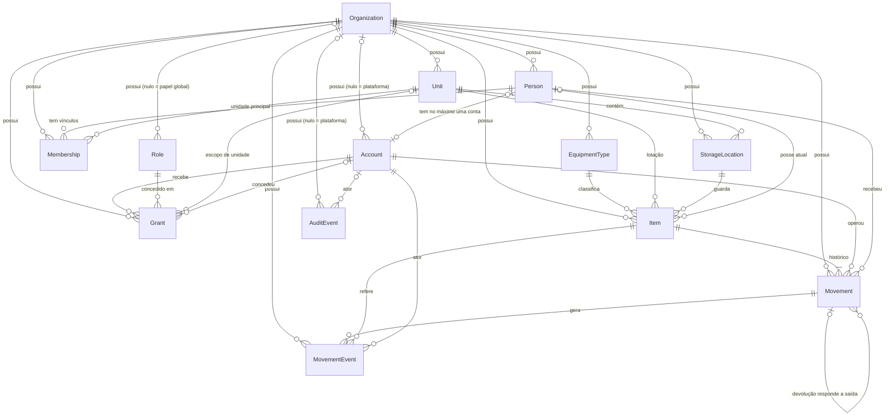

# Modelo de domínio

- Tarefa: SIGAB-011
- Revisão: 2026-10-31, conferida com `backend/sigab/models.py` (migrações `0001` e `0002`)
- Requisitos: RF-01, RF-03, RF-10, RF-12 e RF-60 do [DOC-0011 v0.1](fontes/DOC-0011-analise-de-requisitos-v0.1.md)
- Base: [glossário](glossario.md), [decisão 0002 — papéis e escopos](decisoes/0002-papeis-e-escopos.md), [decisão 0004 — ciclo de vida do item](decisoes/0004-ciclo-de-vida-do-item-individual.md), [ADR 0002](adr/0002-tenancy-autorizacao.md), [ADR 0003](adr/0003-eventos-idempotencia.md), [ADR 0005](adr/0005-api-django-e-frontend-react.md)

Este documento descreve o modelo **implementado**. Onde o código difere das decisões, a diferença está na seção 7; nenhuma delas foi corrigida neste incremento.

## 1. Diagrama



Leitura em blocos:

```text
Estrutura:     Organization ─ Unit ─ StorageLocation
Identidade:    Person ─ Membership          Account (opcional, 0..1 por pessoa)
Acesso:        Account ─ Grant ─ Role(permissions)   escopo: organização ou unidade
Acervo:        EquipmentType ─ Item (lotação: Unit + StorageLocation; posse: Person)
Fatos:         Item ─ Movement ─ MovementEvent        AuditEvent (independente)
```

## 2. Limites de organização

Regra (RF-01): todo dado de negócio pertence a exatamente uma organização, e nenhuma referência atravessa organizações.

- **Todas as entidades de negócio têm `organization_id` próprio**, mesmo quando ele poderia ser derivado de um pai. Isso permite filtrar toda consulta pelo tenant sem junção e torna explícita a verificação de referências cruzadas.
- **Fonte de autoridade:** a organização da requisição vem de `Account.organization` da conta autenticada, nunca do navegador.
- **Referências cruzadas** são rejeitadas em `clean()` (`StorageLocation`, `Membership`, `Account`, `Grant`, `Item`) e nos serviços, que buscam todo objeto já filtrado por `organization=ctx.organization`. Um identificador de outra organização resulta em “não encontrado”, sem revelar a existência do registro.
- **Exceções com organização nula**, restritas ao plano de controle da plataforma:
  - `Account.organization` nula: conta da plataforma (decisão 0002, escopo global);
  - `Role.organization` nula: papel global, utilizável em concessões de qualquer organização;
  - `AuditEvent.organization` nula: ação administrativa sobre registro sem tenant (conta de plataforma ou papel global, pelo Django Admin).
- **`Person` é isolada por organização.** A mesma pessoa física em duas organizações são dois registros sem ligação. Isso reduz o risco de correlação e vazamento entre clientes; unificar exigiria serviço de identidade separado e finalidade e consentimento explícitos.

## 3. Cardinalidades

| Relação | Cardinalidade | Observação |
|---|---|---|
| Organization → Unit, StorageLocation, Person, EquipmentType, Item | 1 : 0..N | |
| Unit → StorageLocation | 1 : 0..N | local pertence a uma única unidade |
| Person → Membership | 1 : 0..N | pessoa pode existir sem vínculo; vários vínculos são permitidos (por exemplo, histórico de matrícula) |
| Membership → Unit (principal) | N : 1 | |
| Person → Account | 1 : 0..1 | pessoa sem conta é o caso comum; conta sem pessoa é admitida (conta técnica ou de plataforma) |
| Account → Grant | 1 : 0..N | sem concessão ativa, a conta não tem permissão alguma |
| Role → Grant | 1 : 0..N | |
| Grant → Unit | N : 0..1 | obrigatório quando `scope_type = unit` |
| EquipmentType → Item | 1 : 0..N | só tipo `individual` aceita item |
| Item → Unit, StorageLocation (lotação) | N : 1 | o local pertence à unidade do item |
| Item → Person (posse atual) | N : 0..1 | preenchido somente durante a posse operacional |
| Item → Movement | 1 : 1..N | a incorporação é a primeira movimentação |
| Movement (devolução) → Movement (saída) | 0..1 : 1 | `related_movement`; uma saída tem no máximo uma devolução (garantido no serviço) |
| Movement → MovementEvent | 1 : 1..N | hoje um evento por movimentação |
| AuditEvent → objeto auditado | N : 1 lógico | por `object_type` + `object_id`, sem chave estrangeira |

## 4. Dicionário de dados

Convenções comuns:

- `id`: UUID v4 gerado pelo servidor, chave primária de todas as entidades. Nunca depende de série, patrimônio, matrícula ou CPF.
- `created_at`, `updated_at`: instantes UTC mantidos pelo Django (todas as entidades exceto `Account`, `MovementEvent` e `AuditEvent`).
- Exclusão física é bloqueada por `on_delete=PROTECT` em todas as chaves estrangeiras; desativação usa `is_active`/`status`.
- “Único na org.” significa restrição única composta com `organization` no banco.

### 4.1 Organization — organização cliente

| Campo | Tipo | Obrig. | Regra |
|---|---|---|---|
| `name` | texto 160 | sim | |
| `timezone` | texto 64 | sim | padrão `America/Fortaleza`; usado só para apresentação, o banco grava UTC |
| `status` | `active` \| `inactive` | sim | |

### 4.2 Unit — unidade

| Campo | Tipo | Obrig. | Regra |
|---|---|---|---|
| `organization` | FK | sim | |
| `name` | texto 160 | sim | |
| `code` | texto 40 | sim | único na org. (`uniq_unit_code_org`) |
| `is_active` | booleano | sim | |

### 4.3 StorageLocation — local de guarda

| Campo | Tipo | Obrig. | Regra |
|---|---|---|---|
| `organization` | FK | sim | igual à da unidade (`clean`) |
| `unit` | FK Unit | sim | |
| `name` | texto 120 | sim | |
| `code` | texto 40 | sim | único na org., não só na unidade (`uniq_location_code_org`) |
| `is_active` | booleano | sim | |

### 4.4 Person — pessoa (RF-03)

Representa o ser humano, independentemente de acesso ao sistema.

| Campo | Tipo | Obrig. | Regra |
|---|---|---|---|
| `organization` | FK | sim | |
| `name` | texto 180 | sim | |
| `functional_name` | texto 120 | não | nome de guerra; exibido no lugar do nome quando preenchido |
| `cpf` | 11 dígitos | não | opcional; fora das telas operacionais comuns; nunca em log, evento ou mensagem de erro; sem restrição única |
| `phone` | texto 24 | não | celular (RF-03) |
| `is_active` | booleano | sim | pessoa inativa não recebe saída |

Os campos de RF-03 que não estão em `Person` ficam onde pertencem: matrícula, posto/graduação e unidade em `Membership`; perfil em `Grant`/`Role`.

### 4.5 Membership — vínculo

Relação funcional da pessoa com a organização.

| Campo | Tipo | Obrig. | Regra |
|---|---|---|---|
| `organization` | FK | sim | igual à da pessoa e à da unidade (`clean`) |
| `person` | FK Person | sim | |
| `registration` | texto 64 | sim | matrícula; única na org. (`uniq_registration_org`) |
| `main_unit` | FK Unit | sim | unidade principal |
| `rank` | texto 80 | não | posto/graduação |
| `is_active` | booleano | sim | a saída exige pessoa ativa **e** vínculo ativo |

### 4.6 Account — conta de acesso

Credencial de autenticação. Estende `AbstractUser` do Django (usuário, senha com hash, `is_active`, `is_staff`, `is_superuser`, `last_login`).

| Campo | Tipo | Obrig. | Regra |
|---|---|---|---|
| `organization` | FK | não | nula só para conta de plataforma; é a fonte de autoridade do tenant |
| `person` | FK Person, única | não | no máximo uma conta por pessoa; mesma organização (`clean`) |
| `session_version` | inteiro | sim | previsto para invalidar sessões abertas; hoje nenhum código o lê nem o incrementa (D-10) |

Ciclos de vida independentes: suspender a conta (`is_active = false`) não altera a pessoa, o vínculo nem o histórico; desativar a pessoa não apaga a conta.

### 4.7 Role — papel

| Campo | Tipo | Obrig. | Regra |
|---|---|---|---|
| `organization` | FK | não | nula = papel global |
| `name` | texto 80 | sim | único na org. (`uniq_role_name_org`) |
| `permissions` | lista JSON de códigos | sim | permissões explícitas; não há herança entre papéis |

### 4.8 Grant — concessão

Atribui um papel a uma conta num escopo.

| Campo | Tipo | Obrig. | Regra |
|---|---|---|---|
| `organization` | FK | sim | igual à da conta, do papel (se não global) e da unidade (`clean`) |
| `account` | FK Account | sim | |
| `role` | FK Role | sim | |
| `scope_type` | `organization` \| `unit` | sim | |
| `unit` | FK Unit | se `unit` | obrigatório no escopo de unidade (`clean`) |
| `is_active` | booleano | sim | |
| `granted_by` | FK Account | não | quem concedeu |
| `revoked_at` | instante | não | revogação preserva a linha |

Avaliação (`sigab/permissions.py`): nega por padrão; concede se existir concessão ativa e não revogada, na organização da conta, cujo papel contenha a permissão e cujo escopo seja a organização ou a unidade do objeto.

### 4.9 EquipmentType — tipo de equipamento (RF-10)

| Campo | Tipo | Obrig. | Regra |
|---|---|---|---|
| `organization` | FK | sim | catálogo privado por organização |
| `name` | texto 160 | sim | único na org. (`uniq_equipment_type_org`) |
| `description` | texto | não | |
| `classification` | `individual` \| `quantitative` | sim | “com registro” e “de estoque” no DOC-0011; imutável quando o tipo tem itens (`save`) |
| `is_active` | booleano | sim | |

### 4.10 Item — item individual (RF-12)

| Campo | Tipo | Obrig. | Regra |
|---|---|---|---|
| `organization` | FK | sim | igual à do tipo, unidade, local e responsável (`clean`) |
| `equipment_type` | FK | sim | classificação `individual` (`clean`) |
| `unit` | FK Unit | sim | lotação |
| `storage_location` | FK | sim | pertence a `unit` (`clean`) |
| `serial_number` | texto 100 | não | único na org. quando preenchido (`uniq_item_serial_org`) |
| `asset_number` | texto 100 | não | patrimônio; único na org. quando preenchido (`uniq_item_asset_org`) |
| `official_identifier` | texto 100 | não | registro oficial (por exemplo, SINARM); sem restrição única |
| `administrative_status` | `active` \| `inactive` | sim | situação administrativa (decisão 0004, 2.1) |
| `condition` | `fit` \| `unfit` | sim | condição física |
| `condition_reason` | texto 200 | se `unfit` | vazio se apto, obrigatório se inapto (`item_unfit_requires_reason`, restrição de banco) |
| `availability` | `available` \| `in_custody` \| `unavailable` | sim | **projeção**; alterada só pelos serviços de movimentação |
| `current_holder` | FK Person | não | preenchido ⇔ `availability = in_custody` |

### 4.11 Movement — movimentação

Operação confirmada sobre um item. Imutável depois de gravada.

| Campo | Tipo | Obrig. | Regra |
|---|---|---|---|
| `organization` | FK | sim | |
| `movement_type` | `incorporation` \| `checkout` \| `return` \| `condition_change` | sim | |
| `item` | FK Item | sim | |
| `operator` | FK Account | sim | quem confirmou |
| `recipient` | FK Person | na saída | destinatário |
| `related_movement` | FK Movement | na devolução | aponta para a saída encerrada |
| `idempotency_key` | UUID | sim | única na org. (`uniq_movement_idempotency_org`) |
| `confirmed_at` | instante UTC | sim | |
| `condition_on_return` | `fit` \| `unfit` | na devolução | |
| `new_condition` | `fit` \| `unfit` | em `condition_change` | |
| `condition_reason` | texto 200 | se inapto | |

### 4.12 MovementEvent — evento de domínio

| Campo | Tipo | Obrig. | Regra |
|---|---|---|---|
| `organization`, `movement`, `item`, `actor` | FK | sim | |
| `event_type` | texto 32 | sim | `item.incorporated`, `item.checked_out`, `item.returned`, `item.condition_changed` |
| `occurred_at` | instante UTC | sim | |
| `schema_version` | inteiro | sim | versão do contrato de `metadata` |
| `metadata` | JSON | sim | mínimo e versionado; sem dados pessoais desnecessários |

### 4.13 AuditEvent — evento de auditoria (RF-60)

| Campo | Tipo | Obrig. | Regra |
|---|---|---|---|
| `organization` | FK | não | nula só em ação sem tenant |
| `actor` | FK Account | não | quem fez, quando conhecido |
| `action` | texto 80 | sim | o quê |
| `object_type`, `object_id` | texto | sim | referência lógica ao objeto |
| `occurred_at` | instante UTC | sim | quando |
| `correlation_id` | texto 64 | sim | liga auditoria, evento e requisição |
| `result` | texto 32 | sim | padrão `success` |
| `changes` | JSON | sim | valor anterior e novo, minimizado |
| `reason` | texto | não | motivo, quando exigido |

`MovementEvent` e `AuditEvent` são imutáveis (`ImmutableModel`): `save` sobre registro existente, `delete` e `update`/`delete` em lote falham. Contratos de evento e auditoria: [ADR 0006](adr/0006-eventos-auditoria-e-estornos.md). O log técnico não é tabela de domínio.

## 5. Identificadores

| Identificador | Entidade | Unicidade | Papel |
|---|---|---|---|
| `id` (UUID) | todas | global | chave interna, estável, sem significado |
| `code` | Unit, StorageLocation | na org. | código legível para operação |
| `registration` (matrícula) | Membership | na org. | identificação funcional da pessoa |
| `cpf` | Person | nenhuma | dado pessoal opcional, não usado como chave |
| `username` | Account | global (Django) | login |
| `name` | EquipmentType, Role | na org. | |
| `serial_number`, `asset_number` | Item | na org., quando preenchidos | identificação física e patrimonial |
| `official_identifier` | Item | nenhuma | registro em órgão externo |
| `idempotency_key` | Movement | na org. | impede dupla confirmação |
| `correlation_id` | AuditEvent | nenhuma | rastreio entre registros de uma mesma requisição |

Identificadores de registro anulado não são reutilizados (decisão 0004, 10.9).

## 6. Invariantes

| # | Invariante | Onde é garantida |
|---|---|---|
| I-01 | toda referência entre entidades fica na mesma organização | `clean()` e consultas filtradas nos serviços |
| I-02 | a organização da requisição vem da conta autenticada | `has_permission`, views e serviços |
| I-03 | sem concessão explícita, nenhuma permissão; papéis não herdam entre si | `has_permission` |
| I-04 | concessão de unidade tem unidade | `Grant.clean` |
| I-05 | pessoa, vínculo e conta têm ciclos independentes; no máximo uma conta por pessoa | modelo (`OneToOneField`) |
| I-06 | matrícula, códigos, nome de tipo/papel, série e patrimônio únicos na org. | restrições do banco |
| I-07 | classificação de tipo em uso não muda | `EquipmentType.save` |
| I-08 | item usa somente tipo individual | `Item.clean` |
| I-09 | local de guarda do item pertence à unidade do item | `Item.clean` |
| I-10 | inapto exige motivo; apto não tem motivo | restrição `item_unfit_requires_reason` e `Item.clean` |
| I-11 | `current_holder` preenchido ⇔ `availability = in_custody` ⇔ existe uma saída sem devolução | serviços (`select_for_update` + atualização condicional) |
| I-12 | saída exige item `active`, `fit`, `available` e destinatário ativo com vínculo ativo | `checkout_item` |
| I-13 | confirmações concorrentes da mesma saída aceitam exatamente uma | atualização condicional em `availability` (validada no PostgreSQL) |
| I-14 | chave de idempotência única por organização | restrição `uniq_movement_idempotency_org` |
| I-15 | movimentação e eventos confirmados não são editados nem apagados, nem em lote | `Movement.save/delete`, `ImmutableModel`, `AppendOnlyQuerySet` (camada de aplicação; [ADR 0006](adr/0006-eventos-auditoria-e-estornos.md#5-imutabilidade)) |
| I-16 | movimentação, evento de domínio, auditoria e projeção do item são gravados na mesma transação | `transaction.atomic` nos serviços |
| I-17 | nenhuma exclusão física em cascata | `on_delete=PROTECT` |

A imutabilidade (I-15) vale na camada de aplicação; operações SQL diretas e o administrador do banco não são bloqueados (pendência conhecida).

## 7. Divergências e lacunas

| # | Divergência | Referência | Impacto |
|---|---|---|---|
| D-01 | `has_permission` concede tudo a `is_superuser`, em qualquer organização | decisão 0002: papel global não lê dados de negócio; suporte sem acesso implícito | conta superusuário atravessa o isolamento. Restringir superusuário ao Django Admin ou removê-lo da avaliação de tenant |
| D-02 | códigos de permissão do código (`inventory.manage`, `movement.execute`) diferem da matriz (`item.create`, `movement.checkout`, `movement.return`) | [matriz 0002](decisoes/0002-papeis-e-escopos.json) | a separação entre saída e devolução da matriz não existe no código |
| D-03 | item pode ser criado sem nenhum identificador (série, patrimônio e oficial vazios) | RF-12: tipo **+ número de identificação** + unidade | exigir ao menos um identificador, sem torná-lo chave |
| D-04 | `administrative_status` tem `inactive`, sem fluxo | decisão 0004: `retired` e `voided` | já registrado na decisão 0004, seção 9 |
| D-05 | localização implícita em `availability` | decisão 0004, seção 7 | aceito no MVP |
| D-06 | isolamento de referências por `clean()`, sem chave estrangeira composta no banco | ADR 0002 | gravação que não passe por `full_clean()` ou pelos serviços pode criar referência cruzada |
| D-07 | `Grant` com escopo `organization` e `unit` preenchida não é rejeitado | — | dado ambíguo; hoje a unidade é ignorada |
| D-08 | `official_identifier` sem restrição única | — | depende da regra do registro oficial (SIGAB-005) |
| D-09 | “uma devolução por saída” garantida só no serviço | — | candidata a restrição única parcial em `related_movement` |
| D-10 | `Account.session_version` não é usado | invariante “suspender conta encerra acesso” | suspensão depende de `is_active`, verificado a cada requisição; troca de senha já invalida sessões pelo hash de sessão do Django; o campo não tem uso e pode ser removido ou adotado para revogação explícita |
| D-11 | auditoria do Django Admin grava só os nomes dos campos alterados (`changes.fields`) | RF-60: valor anterior e novo | cadastros feitos pelo Admin não têm valor anterior e novo; valores pessoais precisam de minimização antes de serem incluídos |

## 8. Rastreabilidade

| Requisito | Onde |
|---|---|
| RF-01 — várias organizações, dados isolados | seção 2; I-01, I-02; D-01, D-06 |
| RF-03 — cadastro de pessoa | 4.4, 4.5, 4.6 |
| RF-10 — tipo com registro ou de estoque | 4.9; I-07, I-08 |
| RF-12 — item com registro: tipo + identificação + unidade | 4.10; seção 5; D-03 |
| RF-60 — quem, o quê, quando, valor anterior e novo, motivo | 4.13; D-11 |
| Pessoa e conta separadas (observação da tarefa) | 4.4, 4.6; I-05 |

Estado do item e transições: [decisão 0004](decisoes/0004-ciclo-de-vida-do-item-individual.md). A [posse operacional](glossario.md#posse-operacional) é uma projeção transacional no item, verificável pelo histórico; não se confunde com custódia, que designa o dever de guarda.
